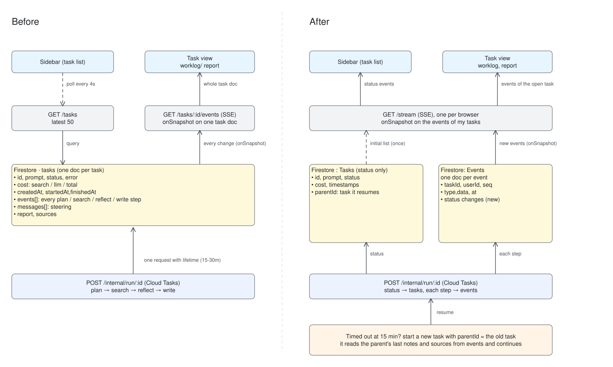

# DeepResearch Web App

## Overall Architecture

- Backend API/ Worker: Cloud Run service (Hono,Node,TS)
- Queue: Cloud Tasks
- Task State/ Events / Research report: Firestore
- Frontend: Single Page Vue application hosted on Vercel.
- Secrets: GCP Secret Manager (`VALYU_API_KEY`, `ACCESS_CODE`), injected as env vars on deploy.
  Access code gates every route except `/health` and `/internal/run` (GCP OIDC), sent as `Authorization: Bearer <code>`
- Model: Gemini 3.8 Flash (Vertex AI)

### Serving HTTP Requests

1. Research question is submitted with `POST /tasks`,
2. Task created in Firestore and handed to Cloud Tasks
3. Returns a `202` with the id.
4. Cloud Tasks calls `/internal/run/:id` with a OIDC token to begin the research.
5. During run, task changes (status, events) are updated to Firestore and backend listens with onSnapshot and streams them over SSE.
6. Frontend keeps one SSE stream for the task being viewed currently (`GET /tasks/:id/events`)
7. Firestore stores the completed research report / sources in the same document.

## Research Pipeline

Research is split into 4 stages, with steps 2–3 looping for up to 4 rounds.

1. **Plan**: LLM call with the system prompt and user prompt (other context: today's date) to output the first batch of searches (structured output).
2. **Search**: searches are queried in parallel on Valyu.
3. **Reflect**: LLM call with the user prompt, notes so far and search results. Outputs updated notes, gaps, and either follow-up searches (back to step 2) or done (step 4).
4. **Write**: LLM call with the user prompt, notes so far and search results to write the report in structured JSON.

The final report is then converted to Markdown, renumbering only the cited sources in the report.

### Using Valyu API (step 2)

Valyu search is only called through 4 scopes (the LLM decides based on the research question).

**Proprietary** (`included_sources`):

- `literature`: `valyu/valyu-pubmed`
- `preprints`: `valyu/valyu-arxiv`, `valyu/valyu-biorxiv`, `valyu/valyu-medrxiv`
- `trials`: `valyu/valyu-clinical-trials`

**Web**:

- `web`: `searchType: "web"`, with a default `instructions` to prefer journals and skip blogs / forums

**Other search arguments**
Filled in by the LLM:

- LLM: `startDate?` / `endDate?`, taken from the research question (e.g. "for the past 5 years")
- LLM: `instructions?` (mainly for web)
- Fixed: `maxNumResults` = 8
- Fixed: `responseLength`= 5000

## Failure Handling

### 1. Budget / time limit exceeded

Cost is tracked on every call: search: `total_deduction_dollars`, LLM: cost calculation based on input and output tokens × the model's price. Every event stores its own cost, and the task keeps a running total (search / LLM / total) that the UI shows live.

Each task has a $1 search budget, a $1 LLM budget, a 10-minute deadline and a maximum of 4 rounds.

- Search: before each round, the worst-case cost of the planned searches (no. of results x the highest per-result price for that scope) is added to what has already been spent.
- LLM: The LLM budget is checked before each reflect call.
- Job Duration: 10min Time since job start (constrained by 15min Cloud Task request)

Write stage still goes through (LLM budget is a softcap) and the report is written from what is collected so far.

### 2. API failures and retries

Every Valyu and Gemini call is wrapped in a retry with exponential backoff and jitter: up to 3 attempts, waiting ~1s then ~2s.

- Timeouts: 30s per search, 60s per LLM call. A timeout counts as a failed attempt.
- Only transient errors are retried (429, 5xx, timeouts, network errors). Bad LLM output that fails the schema is not retried.
- Search: a round's searches run in parallel with `Promise.allSettled`, task only failed if all searches fail, partial failure can still be addressed by the next round of search
- LLM: if a plan / reflect / write call still fails after 3 attempts, the task fails with the error shown.

### 3. Race conditions

- `queued` tasks: `queued` tasks are updated to `running` or `cancelled` using a Firestore transaction so that duplicate cloud tasks delivery or cancellations cant race each other.
- Steering / events: the worker appends events while the API appends steer messages to the same document. Both use `arrayUnion`, an atomic append, so neither write overwrites the other.

## Considerations

### Why Cloud Run + Cloud Tasks

Research is network / IO-bound (Gemini / Valyu API calls) instead of CPU-bound, prioritise for concurrency

- Cloud Run (used for `internal/run/:id`): a container service that serves HTTP requests and autoscales, including down to zero (idle)
- Cloud Tasks: a simple way to rate-limit runs (max 5 at once, protecting my Cloud Run service and the Valyu / Gemini rate limits), and it handles auth to the worker endpoint with an OIDC token.

Limitations: 15min cap

- Single run can only take up to 15mins and long research runs will be cut off (my implementation has a soft 10min cutoff) and requires checkpointing between rounds

### Model choice: Gemini 3.8 Flash

Reasons:

1. fast and cheap (constrained by 15min request limit)
2. SDK allows structured JSON output, deterministic way to call search API / show updates on frontend.
3. Auth handled with GCP cloud run service account

Improvements:

1. Each LLM API call is stateless that is given the context (history / prompts) it needs: flexibility to choose model based on the research stage possibly a faster/cheaper model for planning and smarter model for writing stage.

## Additional Feature 1: Live task updates (work log)

For researchers who don't want the research to be a black box. Instead of waiting for a final report, the user sees live updates of how the model is approaching the research question: the searches it planned (scope, query, date range), how many results each returned, and after each round its notes, the gaps it found, and the follow-up searches it chose.

1. **Visibility:** : the user can see how the research is going / running costs, giving live visibility into the api reliability or quality of results surfaced by Valyu for that research domain in real time.
2. **Catch problems early:** Able to spot any issues and make changes especially when the running a full job could take >30mins / be expensive.

**Additional detail: sidebar.** The open task streams its updates over SSE, while the sidebar polls `GET /tasks` (every 4s while any task is queued or running, every 30s otherwise). Users can keep track of multiple concurrent running threads.

## Additional Feature 2: Steering / Cancel

For researchers who want to point the research at a specific area while it's running, for example when the model is stuck on one angle or approaching the question the wrong way. Correcting a run mid-way is cheaper than waiting for a bad report and starting again.

- **Steering:** the user sends a message while the task is running. At the next checkpoint the model re-plans straight away with the message, and every message is passed to later reflect and write steps (if two messages conflict, the later one wins).
- **Cancel:** stops the run at the next checkpoint. The task shows as cancelled and keeps the cost it had spent so far.

## Scaling to 10x and 100x



### 10x: multi-user

- Breaks: everyone shares one access code and one task list.
- Change: an auth layer (Firebase Auth / Identity Platform) and a `userId` on every task, so each user only sees and polls their own tasks. Per-user quotas on runs and cost.
- The queue limit of 5 on Cloud Tasks/ concurrency of Cloud Run still scalable.

### 100x: teams and longer tasks

- Teams: sharing reports, sources and artifacts across a team is relational data, so the durable parts move to Postgres (users, teams, tasks, reports, sources, citations). The same paper can then be reused across tasks instead of stored once per task.
- Runs longer than 30 minutes: Cloud Tasks caps a single dispatch at 30 minutes, so each round would become its own Cloud Task, with the notes and source pool checkpoint to the database between rounds. This also lets a crashed run resume from its last round instead of staying `running`.

- Longer tasks: current implementation has every SSE update to re-send the whole task document, events and report included, so the cost grows with task length.
  Events move to their own collection, one small doc per event tagged with `taskId` and `userId` (or just `taskId` under a `userId` document). This also enables a single stream per browser (replacing the polling needed for the sidebar).

### To measure

- Queue wait (`createdAt` → `startedAt`) and run time
- Cost per task, split into search and LLM
- Open SSE connections and instance count
- Firestore reads and writes per minute

## Research Orchestration Improvements

### Increasing Rounds

Increasing the number of search, reflect rounds while capping searches per round, allowing searches to be crafted better (based on new context/ primary-sources)

Prompt:

> What do randomised controlled trials since 2020 show about GLP-1 receptor agonists (semaglutide, tirzepatide) for outcomes beyond weight loss, such as cardiovascular, kidney and addiction, and which questions remain unresolved?
> Same GLP-1 question, same code; only the shape of the searching changes.

| Setup                                                         | Searches per round | Rounds (taken / allowed) | Searches used | Cost  | Time | Cited | Primary trial papers (of 4) |
| ------------------------------------------------------------- | ------------------ | ------------------------ | ------------- | ----- | ---- | ----- | --------------------------- |
| [Single pass](docs/experiments/glp1-single-pass-6-at-once.md) | 6                  | 1 / 1                    | 6             | $0.23 | 77s  | 25    | 0                           |
| [1 per round](docs/experiments/glp1-1-per-round.md)           | 1                  | 5 / 8                    | 5             | $0.30 | 137s | 21    | 2                           |
| [Production](docs/experiments/glp1-production-3-per-round.md) | up to 3            | 3 / 4                    | 9             | $0.30 | 125s | 33    | 4                           |

Primary trial papers = the original results papers for SELECT, FLOW, SUMMIT and SURPASS-4 (kidney), rather than reviews or summaries of them.

Observations

1. Production cites the original trial papers. After round 1, reflect searched for the trials by name (SELECT, FLOW, SUMMIT). The single pass found the same trials but cited them through reviews and summaries, e.g. FLOW through a "Weekly Journal Scan" digest instead of the NEJM paper.
2. Production missed something the other two found: a semaglutide RCT for alcohol use disorder (Hendershot 2025). Its report says no completed semaglutide addiction RCTs exist, which is wrong. Searching wide early matters.
3. 1 search per round did worst. It cost the most and cited the fewest sources. The gap count stayed at 3 for three rounds (3, 3, 3, 2, 0), since each round only brought in ~7 new sources.
4. Extra rounds mostly cost time. Each reflect round added ~20–25s but only ~$0.02–0.03.

Around 3 searches per round over a few rounds seems to work best. The first round covers the question broadly, and later rounds let the model autoregulate and have the choice to go deeper on specific parts, like a single trial.

## Others

1. Adversarial review: A review step, ideally with different model, could improve claim grounding, and also evaluate the strength of the evidence / look for contradictions as well as missing viewpoints.
2. Search Query Caching: Caching could enable researchers to try multiple runs (with different models/ slight changes in question) to surface new results, could also be a way for devs to do evaluation runs on their workflow orchestration.
3. Cheaper sub-agents for searching: a cheaper model calls Valyu as a tool, reads the raw results and returns structured evidence (`sourceId`, key findings, numbers, quote) to the main model. The write step reads raw excerpts today and is the biggest LLM cost, so this could cut cost, as long as the evidence stays tied to its source ids for citations.

## Local Setup

```bash
cd backend && cp .env.example .env    # fill in VALYU_API_KEY, ACCESS_CODE
gcloud auth application-default login  # Vertex AI + Firestore
npm install && npm run dev             # http://localhost:3000

cd ../frontend && echo "VITE_API_URL=http://localhost:3000" > .env
npm install && npm run dev
```

Locally, tasks run in-process instead of through Cloud Tasks. `STORE=memory PIPELINE=fake` runs fully offline.

`backend/.env.example`:

```bash
PORT=3000
STORE=firestore # where task state lives: firestore, or memory (lost on restart)
PIPELINE=valyu # valyu = real research (Valyu + Gemini), fake = offline pipeline with canned events
GOOGLE_CLOUD_PROJECT="valyu-research" # GCP project for Firestore and Vertex AI (uses your gcloud login locally)

# secrets: copied into Secret Manager by deploy/secrets.sh, never sent to the browser
VALYU_API_KEY=
ACCESS_CODE=
# optional: model per stage (plan + reflect, write)
# MODEL_PLAN=gemini-3.8-flash
# MODEL_WRITE=gemini-3.8-flash

# deployment only (set by deploy/deploy.sh); leave unset locally to run tasks in-process
# QUEUE=cloudtasks
# TASKS_LOCATION= TASKS_QUEUE= TASKS_SA= WORKER_URL=
```

## Deployment

Backend (GCP), from the repo root. The scripts read `VALYU_API_KEY` and `ACCESS_CODE` from `backend/.env`:

```bash
bash deploy/setup.sh     # once: enables APIs, creates service accounts, the queue and secrets (Firestore database created in the console)
bash deploy/deploy.sh    # build from backend/Dockerfile and deploy to Cloud Run (re-run to update)
bash deploy/undeploy.sh  # delete the service and pause the queue
```

Frontend (Vercel):

```bash
cd frontend
npx vercel --prod        # set VITE_API_URL to the Cloud Run URL in the Vercel project settings
```

## API Usage

Every route except `/health` needs the access code.

```bash
URL=https://research-api-969718812715.asia-southeast1.run.app
CODE=<access code>

# create a task → {"task_id":"…","status":"queued"}
curl -X POST "$URL/tasks" -H "Authorization: Bearer $CODE" \
  -H "content-type: application/json" \
  -d '{"prompt":"How has the upper bound on the matrix multiplication exponent improved since 2020?"}'

# status, events, and the report once completed
curl -H "Authorization: Bearer $CODE" "$URL/tasks/<task_id>"

# live updates (SSE)
curl -N "$URL/tasks/<task_id>/events?code=$CODE"

# steer or cancel a running task
curl -X POST "$URL/tasks/<task_id>/messages" -H "Authorization: Bearer $CODE" \
  -H "content-type: application/json" -d '{"text":"focus on results from 2024 onwards"}'
curl -X POST "$URL/tasks/<task_id>/cancel" -H "Authorization: Bearer $CODE"
```

## Example Output

Completed runs from the deployed service. Each JSON has the full task: the generated Valyu searches (scope / query / date window), selected sources, cost, and the final Markdown report.

- Matrix multiplication exponent ω since 2020: [report](docs/examples/matmul-omega.md) · [JSON](docs/examples/matmul-omega.json)
- GLP-1 RCTs beyond weight loss: [report](docs/experiments/glp1-production-3-per-round.md) · [JSON](docs/experiments/glp1-production-3-per-round.json)

## Testing

- `bash deploy/smoke.sh ["question"]`: one real task end to end against the deployed service (health → create → poll until done → print the report). `BASE=http://localhost:3000` runs it against a local server.
- `STORE=memory PIPELINE=fake npm run dev`: the full API and frontend flow offline, with a fake pipeline that emits realistic events (a prompt containing "fail" exercises the failed state).

## Known Limitations

- Stuck `running` tasks: if an instance crashes mid-run, Cloud Tasks retries but the claim only accepts `queued` tasks, so the task stays `running`. Fix: a heartbeat / lease plus a sweeper that fails stale runs.
- 15-minute cap per run: a run is a single request (soft 10-minute deadline inside it).
- LLM budget is a soft cap: checked before each reflect, and the write step always runs, so a task can go one reflect + one write over $1.
- Citations are checked for existence, not support: a claim can cite a real source that doesn't back it (e.g. a trial design paper cited for its results).
- Valyu publication dates are sometimes crawl dates or year-only, which weakens date filtering.
- Retry backoff is short (~1s, ~2s): a minute-long Valyu outage outlasts it; reflect re-asks lost topics in the next round instead.
- One shared access code, no user accounts; `?code=` on the SSE URL can end up in logs.
- Events are an array in one Firestore document, re-sent in full on every SSE update,
